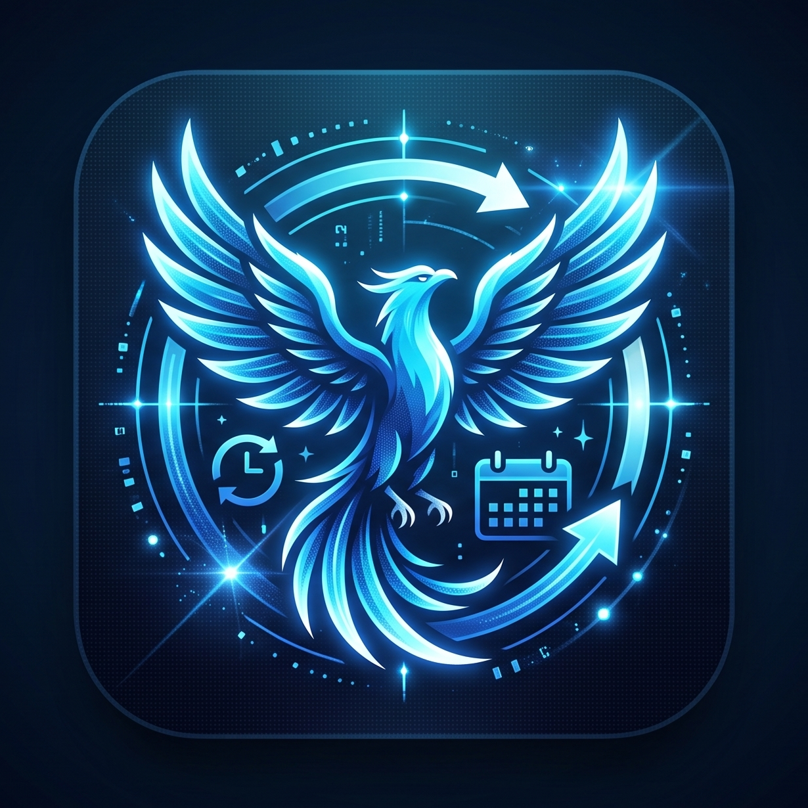

# Google Sync Shift (グーグル・シンク・シフト)

> **「なぞって、決めて、一括同期。」**  
> スマホ・PCのタイムラインを直感的にドラッグするだけで、Googleカレンダーへ神速一括登録できる次世代タイムスケジュールWebアプリケーション。

---

## 💡 アプリケーション概要

**Google Sync Shift** は、アルバイトのシフト管理、プライベート、事業の予定作成など、複数の時間枠をGoogleカレンダーに登録する際の手間を極限までゼロにするために生まれたWebアプリケーションです。

従来の「日付を選び、開始時刻・終了時刻をプルダウンで指定し、保存して…」という面倒な登録作業を完全に過去のものにします。  
画面上のカレンダーを指やマウスで**ビーッとなぞるだけ**で時間帯を直感的に指定し、何コマでもまとめてワンタップでGoogleカレンダーへ一括登録できます。

---

## ⚡ 主な特徴・機能一覧

### 1. 直感的な週表示タイムライン & ドラッグ選択
- **7:00 〜 24:00（30分刻み）× 月〜日（7日間）** のグリッド表示。
- PCのマウスドラッグ、スマホの指タッチによる**なぞるだけの範囲選択**に対応。
- 画面端まで引っ張ると**自動で上下にスクロールする「Auto-Scroll追従機構」**を搭載。14:00〜21:00などの見切れる長時間スケジュールも、指を離さずに一気に一本で指定可能。

### 2. 誤操作ゼロ！スマホ1画面完全フィット設計
- スマホ表示時でも**月〜日の7日間が1画面にぴったり収まるスリムグリッド**を採用。
- 横スクロールを完全排除したため、「横に動かそうとして意図せず時間帯を選択してしまう」というスマホ特有のストレス・誤爆が一切起きません。
- ヘッダー・操作バー・フッターは完全固定。カレンダー領域だけが独立して快適にスクロールします。

### 3. 何本でも連続配置できる「複数キューイング」
- 月・水・金のシフトや、1日の中の複数コマ（昼・夜）など、画面上に**未確定の予定を何本でも連続で配置**可能。
- 登録前は**「薄い赤の点線＆パルス点滅」**で視覚的にキープされ、Googleカレンダー登録後は**「鮮やかなブルーの実線ブロック」**へと鮮やかに変化します。

### 4. 秒速の件名（タイトル・メモ）入力
- ドラッグ終了と同時に件名入力ポップアップが自動展開。
  - そのまま **Enterキー（または決定タップ）** ➔ デフォルト名義（例: `バイト 予定`）で秒速確定。
  - 文字を入力 ➔ `早番レジ`、`品出し`、`MTG` など好きな件名に一瞬で書き換え可能。
- 画面上の未登録ブロックをタップして、後から何度でも件名を再編集できます。

### 5. Google Calendar API（OAuth 2.0）完全連携
- **マルチアカウント・マルチカレンダー対応**:
  - `CalendarList.list` により、「メイン」「バイト用」「プライベート」「事業用」など、アカウントに紐づくカレンダーを全自動で取得し、プルダウンで瞬時に切り替え。
- **神速バッチ登録 (`events.insert`)**:
  - 画面下の「選択した○件を一括登録」ボタンを押すだけで、指定したカレンダーへ全件並列でダイレクト書き込み。
- **既存予定の可視化 & カレンダーからの直接削除**:
  - すでにGoogleカレンダーに入っている予定も自動描画。右上の「×」ボタンからGoogleカレンダー上の予定を直接キャンセルできます。

### 6. ノーストレスな「完全サイレント自動ログイン」
- 初回に1回認証を許可すれば、次回からは**アプリを開くだけで全自動ログイン**。
- ボタンを一切押さなくても、開いた瞬間からGoogleカレンダーと同期された状態で立ち上がります。

---

## 🛠 技術スタック
- **フロントエンド**: HTML5, CSS3 (Modern Grid / Flexbox / CSS Variables), Vanilla JavaScript (ES6+ / Pointer Events API)
- **API / 認証**: Google Identity Services (GIS), Google Calendar API v3 (REST / OAuth 2.0 Token Model)
- **インフラ / 実行環境**: ブラウザ完結型 SPA（Python / Node等でローカル起動可能、静的ホスティング対応）

---

## 🎯 こんな人におすすめ
- 毎週・毎月のシフト希望や決定シフトをGoogleカレンダーへ手動入力するのが苦痛な方
- 1日に複数のコマ（昼・夜など）を連続でパパッと登録したい方
- 仕事用・バイト用・個人用のカレンダーをスマートに使い分けている方
